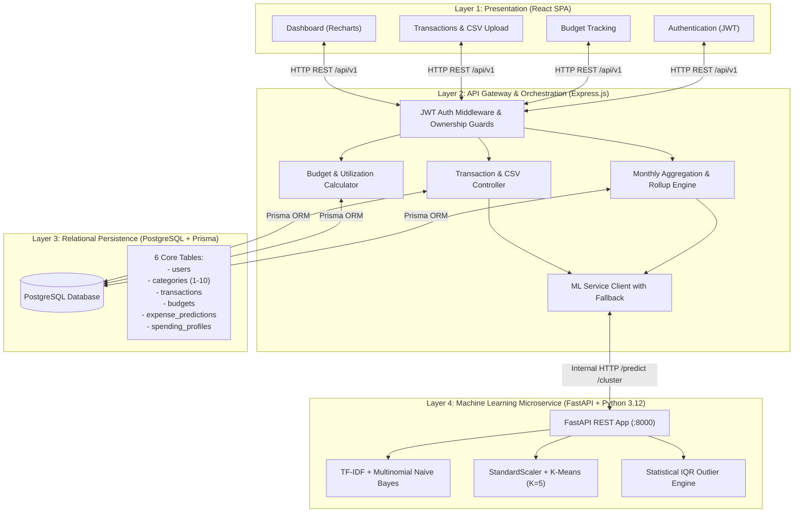

# SpendSense: System Architecture & Technical Specification

**Project:** SpendSense – Smart Expense Analyzer & Spending Pattern Detector  
**Course:** Semester-5 Data Warehousing & Mining (DWM)  
**Architecture:** Layered Decoupled Microservice Architecture (Client-Gateway-Worker)  

---

## 1. High-Level Architecture Diagram

---

## 2. Core Architectural Principles

1. **Private ML Microservice:** The Python FastAPI service runs on an internal network (`localhost:8000`) and is **never exposed directly to public browsers**. All requests flow through Express for JWT validation and user tenancy verification.
2. **Resilience & Graceful Degradation:** If the Python ML microservice is unreachable or times out (>2000ms), Express activates an internal keyword heuristic fallback. User transaction creation never fails due to an ML service outage.
3. **Multi-Tenancy & Data Isolation:** Every database operation in Express enforces strict user ownership (`where: { userId: req.user.id }`), preventing cross-user data access.
4. **Precision Financial Math:** All monetary amounts are stored in PostgreSQL using `@db.Decimal(12, 2)` to eliminate floating-point rounding errors.
5. **Decoupled Training vs. Inference:** Model training runs offline via batch scripts (`train_classifier.py`, `train_clustering.py`), outputting immutable serialized `.joblib` artifacts loaded read-only into memory on FastAPI startup.
